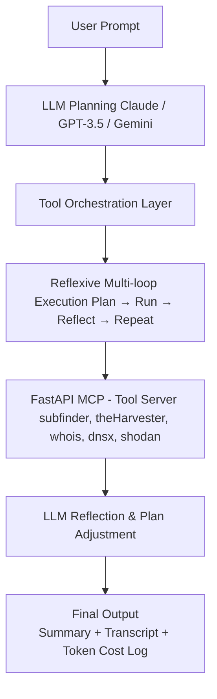

# OSINT Agentic AI Pipeline

A modular, LLM-driven OSINT automation framework that leverages Claude, GPT, and Gemini for intelligent tool orchestration. Powered by FastAPI and real CLI tools for reconnaissance and analysis.

---

##  Features

-  LLM-based multi-loop planning & reflection (Claude, GPT-3.5, Gemini)
-  Reflexive execution loop for smart tool usage
-  Short-term memory & transcript logging
-  FastAPI MCP server to run tools like:
  - `subfinder`
  - `theHarvester`
  - `whois`
  - `dnsx`
  - `shodan`
- Token & cost tracking per LLM with hard limit

---

## Architecture


---

##  Tools Used

| Tool          | Function                                   |
|---------------|--------------------------------------------|
| Claude        | Primary planner, reasoner, and summarizer  |
| GPT-3.5 Turbo | Optional planner or summarizer             |
| Gemini        | Optional backup model                      |
| subfinder     | Subdomain enumeration                      |
| theHarvester  | Email + host OSINT                         |
| dnsx          | DNS probing & IP resolution                |
| shodan        | IP fingerprinting                          |
| whois         | Domain ownership data                      |
| FastAPI       | Backend MCP control for tool routing       |

---

## 📁 Project Structure
```bash
.
├── llm_client.py # Core LLM control loop
├── mcp_server.py # FastAPI backend for tool execution
├── Dockerfile # Docker image definition
├── build.sh # Shell script to build Docker image
├── run.sh # Shell script to run container
├── requirements.txt # Python dependencies
├── logs/ # Run memory + transcript logs
├── .env # Your secret API keys (not committed)
└── README.md
```

---

## Setup

```bash
git clone https://github.com/codex500/Osint-Agentic-AI
cd Osint-Agentic-AI

python3 -m venv venv
source venv/bin/activate

pip install -r requirements.txt
```
## Configure .env
In the project root, create a .env file:

```bash
CLAUDE_API_KEY=your-anthropic-key
SHODAN_API_KEY=your-shodan-key
OPENAI_API_KEY=your-openAi-key
GEMINI_API_KEY=your_gemini_key_here
```
## Docker Setup
First Install Docker into your system and for that you can follow the standard instruction available on: https://www.docker.com/products/docker-desktop/
Build Docker Image
```bash
chmod +x build.sh
./build.sh
```
Run Docker Container
```bash
chmod +x run.sh
./run.sh
```

You can give any recon-related prompt:
```bash
python3 llm_client.py "Run full recon on example.com" --model claude
```
Or use GPT/Gemini:
```bash
python3 llm_client.py "Enumerate emails and probe DNS on example.com" --model gpt/gemini
```

